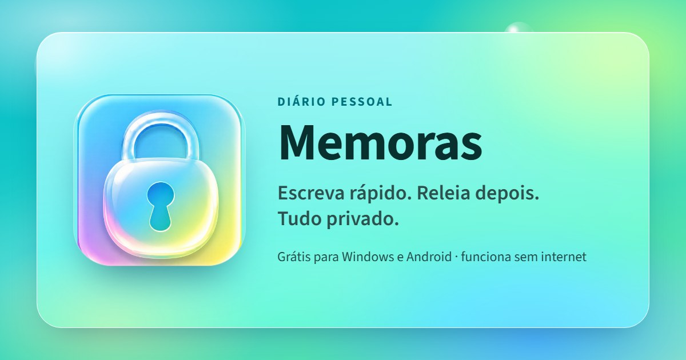

<p align="center">
  <a href="https://memoras.cyberhat.com.br"></a>
</p>

<p align="center">
  <a href="https://github.com/costanoy/Memoras/releases/latest/download/Memoras-Setup.exe"><b>Baixar para Windows</b></a> · <a href="https://github.com/costanoy/Memoras/releases/latest/download/Memoras.apk"><b>Baixar para Android</b></a> · <a href="https://memoras.cyberhat.com.br">Site</a>
</p>

# Memoras

Diário pessoal privado para computador e celular. Um lugar para guardar o que você pensa, sem distração, com cadernos para o que você quer reler e uma agenda para planejar cada dia. Funciona sem internet, protege tudo com criptografia e só abre para você.

- **Diário**: escreva do jeito que vier; cada dia guarda o horário de cada trecho.
- **Cadernos**: textos para reler sempre, com títulos e listas. Os mais usados ficam fixados no alto.
- **Agenda**: o plano de cada dia, com tarefas para marcar, e o Resumão com tudo o que vem pela frente, dia a dia. O que ficou por fazer passa para amanhã.
- **Sem internet e sem conta**: tudo fica no aparelho. A conta é opcional e serve só para sincronizar entre aparelhos.
- **Criptografia de ponta a ponta**: o servidor só guarda texto cifrado e nunca recebe a sua senha.
- **Mini-Memoras** no Windows: um botão na barra de título (ou Ctrl+Shift+M) deixa o app do tamanho de um bloco de notas, para ficar ao lado do que você está fazendo, e pode ficar por cima das outras janelas.
- **PIN e digital** para trancar a tela, 10 temas, atualização automática no Windows e aviso de versão nova no Android.

## Como é feito

Feito a partir de `design_handoff_memoras/`. É um app web instalável (PWA): React + Vite + TypeScript. A mesma base serve os dois formatos; abaixo de 720 px de largura entra o layout de celular. No Windows ele roda com Electron e no Android com Capacitor; as contas e a sincronização usam o Supabase.

## Rodar

```
npm install
npm run dev       # desenvolvimento
npm run build     # gera dist/
npm run preview   # serve dist/ (com uso offline)
```

Precisa de `https` ou `localhost`, porque a criptografia usa a Web Crypto do navegador.

## App de Windows (.exe)

```
npm run desktop   # abre o app de desktop sem instalar
npm run dist      # gera release/Memoras-Setup.exe
npm run release   # publica .exe e .apk no GitHub Releases
```

O app instalado procura versão nova em `github.com/costanoy/Memoras` (Releases) ao abrir e a cada 4 horas, baixa em segundo plano e instala ao fechar. Para lançar uma versão: suba o `version` no `package.json` e rode `npm run release` (usa o login do `gh`). O script publica o release; o arquivo `latest.yml` que vai junto é o que o app consulta.

O instalador não tem assinatura digital, então o Windows mostra o aviso do SmartScreen na primeira instalação.

## App de Android (.apk)

```
npm run apk       # gera release/Memoras.apk assinado
npm run release   # publica .exe e .apk juntos no release v<versão>
```

O APK é assinado com a chave em `~/.memoras/` (`memoras-release.jks` e `keystore.properties`), fora do repositório. **Faça backup dessa pasta:** sem ela, nenhuma versão nova instala por cima da atual, e quem já tem o app precisaria desinstalar e perder os dados do aparelho.

A versão do app (Windows e Android) vem do `version` do `package.json`. Suba esse número antes de cada `npm run release`.

## Contas e sincronização (opcional)

Sem configuração o app funciona inteiro, só no aparelho. Para ligar contas:

1. Crie um projeto no Supabase e rode `supabase/schema.sql` no SQL Editor.
2. Copie `.env.example` para `.env` e preencha a URL e a chave anônima (ou a publishable). O `npm run release` não publica sem elas, para nenhuma versão sair sem contas.
3. Em Authentication, URL Configuration: em Site URL, o endereço do site; em Redirect URLs, `memoras://senha` e `https://memoras.cyberhat.com.br/confirmado.html`. A segunda é a página "Seu email foi confirmado!", para onde vai o link de confirmação do cadastro (`site/confirmado.html`, definida em `src/sync.ts`). A primeira é o endereço que o link de "Esqueci minha senha" abre o app instalado (registrado em `electron/main.cjs` e no `AndroidManifest.xml`). Para testar no navegador, acrescente também o endereço do servidor local.
4. Para outras pessoas receberem os emails de confirmação e de nova senha, configure um SMTP próprio em Authentication, Email (seção Notifications), SMTP Settings. Recomendado: Resend, enviando por `memoras.cyberhat.com.br`, com host `smtp.resend.com`, porta 465, usuário `resend` e uma chave de API do Resend como senha. O email padrão do Supabase só envia para quem é membro do projeto.
5. Com o SMTP próprio, troque os modelos "Confirm signup" e "Reset password" (Authentication, Email, Templates) pelos de `supabase/emails/`, em português. O assunto de cada um está na primeira linha do arquivo.

## Como os dados ficam

- **No aparelho:** IndexedDB (`memoras`). Anotações do diário (`notes`), Cadernos e Agenda (`items`) e preferências (`kv`).
- **Cadernos e Agenda:** no servidor ficam na mesma tabela `notes`, com o tipo dentro do texto cifrado; o servidor não sabe o que é diário, caderno ou tarefa. Um caderno mudado em dois aparelhos ao mesmo tempo não perde texto: a versão do outro aparelho vira uma cópia "(outra versão)". Tarefas se juntam campo a campo.
- **No servidor:** só texto cifrado (AES-GCM). Uma chave do diário é criada no aparelho e guardada no servidor cifrada duas vezes: com a senha e com a chave de recuperação. A senha digitada não é enviada; o login usa um valor derivado dela.
- **PIN:** é uma tranca da tela neste aparelho, guardada como hash. Não cifra os dados no disco.
- **Junção entre aparelhos:** cada trecho, o título e o estado da anotação carregam o horário da última mudança; vale o mais recente de cada um (`merge` em `src/lib/notes.ts`).

## Onde está cada coisa

- `src/store.ts`: estado, navegação, anotações, regras do PIN.
- `src/sync.ts`: conta, chaves e sincronização com o Supabase.
- `src/lib/`: criptografia, IndexedDB, modelo das anotações (`notes.ts`) e de Cadernos e Agenda (`items.ts`), datas.
- `src/screens/`: as telas (`Docs.tsx` são os Cadernos; `Agenda.tsx`, a Agenda). `src/styles.css` e `src/themes.ts`: visual e os 10 temas.
