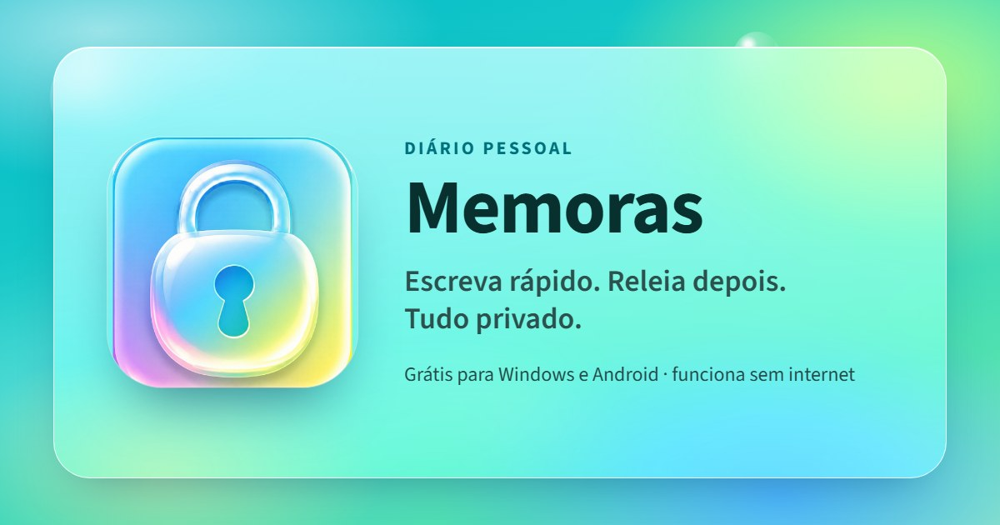

<p align="center">
  <a href="https://memoras.cyberhat.com.br"></a>
</p>

<p align="center">
  <a href="https://github.com/costanoy/Memoras/releases/latest/download/Memoras-Setup.exe"><b>Baixar para Windows</b></a> · <a href="https://github.com/costanoy/Memoras/releases/latest/download/Memoras.apk"><b>Baixar para Android</b></a> · <a href="https://memoras.cyberhat.com.br">Site</a>
</p>

# Memoras

Diário pessoal privado para computador e celular. Um lugar para guardar o que você pensa, sem distração, com cadernos para o que você quer reler e uma agenda para planejar cada dia. Funciona sem internet, protege tudo com criptografia e só abre para você.

- **Diário**: escreva do jeito que vier; cada dia guarda o horário de cada trecho.
- **Cadernos**: textos para reler sempre, com títulos e listas. Os mais usados ficam fixados no alto.
- **Agenda**: o plano de cada dia, com tarefas para marcar, e o Resumão com tudo o que vem pela frente, dia a dia. O que ficou por fazer passa para amanhã.
- **Sem internet e sem conta**: tudo fica no aparelho. A conta é opcional e serve só para sincronizar entre aparelhos.
- **Criptografia de ponta a ponta**: o servidor só guarda texto cifrado e nunca recebe a sua senha.
- **Mini-Memoras** no Windows: um botão na barra de título (ou Ctrl+Shift+M) deixa o app do tamanho de um bloco de notas, para ficar ao lado do que você está fazendo, e pode ficar por cima das outras janelas.
- **PIN e digital** para trancar a tela, 10 temas, atualização automática no Windows e aviso de versão nova no Android.

## Como é feito

É um app web instalável (PWA): React + Vite + TypeScript. A mesma base serve os dois formatos; abaixo de 720 px de largura entra o layout de celular. No Windows ele roda com Electron e no Android com Capacitor; as contas e a sincronização usam o Supabase.

## Rodar

```
npm install
npm run dev       # desenvolvimento
npm run build     # gera dist/
npm run preview   # serve dist/ (com uso offline)
```

Precisa de `https` ou `localhost`, porque a criptografia usa a Web Crypto do navegador.

## Apps de Windows e Android

O Windows roda com Electron (`npm run desktop` abre sem instalar; `npm run dist` gera o instalador) e o Android com Capacitor (`npm run apk`). Os instaladores prontos ficam nos [Releases](https://github.com/costanoy/Memoras/releases/latest), e o app do Windows se atualiza sozinho.

## Contas e sincronização (opcional)

Sem configuração o app funciona inteiro, só no aparelho. Para ligar contas, crie um projeto no Supabase, rode `supabase/schema.sql` e preencha `.env` a partir de `.env.example`.

## Como os dados ficam

- **No aparelho:** IndexedDB (`memoras`). Anotações do diário (`notes`), Cadernos e Agenda (`items`) e preferências (`kv`).
- **Cadernos e Agenda:** no servidor ficam na mesma tabela `notes`, com o tipo dentro do texto cifrado; o servidor não sabe o que é diário, caderno ou tarefa. Um caderno mudado em dois aparelhos ao mesmo tempo não perde texto: a versão do outro aparelho vira uma cópia "(outra versão)". Tarefas se juntam campo a campo.
- **No servidor:** só texto cifrado (AES-GCM). Uma chave do diário é criada no aparelho e guardada no servidor cifrada duas vezes: com a senha e com a chave de recuperação. A senha digitada não é enviada; o login usa um valor derivado dela.
- **PIN:** é uma tranca da tela neste aparelho, guardada como hash. Não cifra os dados no disco.
- **Junção entre aparelhos:** cada trecho, o título e o estado da anotação carregam o horário da última mudança; vale o mais recente de cada um (`merge` em `src/lib/notes.ts`).

## Onde está cada coisa

- `src/store.ts`: estado, navegação, anotações, regras do PIN.
- `src/sync.ts`: conta, chaves e sincronização com o Supabase.
- `src/lib/`: criptografia, IndexedDB, modelo das anotações (`notes.ts`) e de Cadernos e Agenda (`items.ts`), datas.
- `src/screens/`: as telas (`Docs.tsx` são os Cadernos; `Agenda.tsx`, a Agenda). `src/styles.css` e `src/themes.ts`: visual e os 10 temas.

---

Feito por [Vinícius Costa Magalhães](https://portfolio.cyberhat.com.br)
